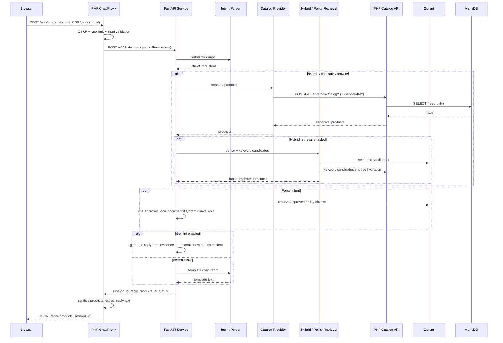

# Architecture

SouqSmart is a read-only FastAPI AI shopping assistant integrated into the NiceShop PHP storefront. The browser never calls FastAPI directly; all chat traffic flows through the NiceShop PHP chat proxy (`POST /ajax/chat`), which forwards authenticated requests to FastAPI.

## Component Responsibilities

| Component | Responsibility |
|---|---|
| Browser chat widget | Captures user messages and displays replies/product cards; sends via PHP proxy |
| PHP chat proxy (`/ajax/chat`) | CSRF verification, rate limiting, input validation, proxies to FastAPI with `X-Service-Key`, sanitizes upstream errors |
| FastAPI (`app/main.py`) | HTTP layer: routes, middleware, service-key auth, error handling, session orchestration |
| Intent parser (`app/intents.py`) | Parses messages into structured intent (deterministic rules, optional Gemini) |
| Services (`app/services.py`) | Product ranking, comparison, deterministic fallback replies, intent parsing entrypoint |
| Catalog provider (`app/catalog.py`) | Abstract catalog interface; `PHPProvider` calls NiceShop, `FixtureProvider` for tests |
| Hybrid retriever (`app/rag/retriever.py`) | Dense Qdrant plus PHP keyword retrieval, reciprocal-rank fusion, PHP hydration |
| Knowledge manager (`app/rag/knowledge.py`) | Qdrant policy retrieval and approved local policy fallback |
| Sessions (`app/sessions.py`, `app/sessions_db.py`) | Memory or SQLite-backed sessions with TTL, turn limit, and retrieval metadata |
| Security (`app/security.py`) | `X-Service-Key` verification using constant-time comparison |
| Response generator (`app/response_generator.py`) | Gemini generation grounded on verified product/policy evidence and recent context |
| Schemas (`app/schemas.py`) | Pydantic request/response validation |
| PHP catalog API (`/internal/catalog/*`) | Read-only SQL queries against MariaDB; canonical product serialization |
| MariaDB / MySQL | Product data source of truth (NiceShop-side only) |

## Request Lifecycle (Chat)



## Intent Parsing

Two parser implementations are available behind a common `IntentParser` interface:

1. **DeterministicIntentParser** (default) — rule-based, supports English and Egyptian Arabic. No network, no API key, fully offline.
2. **LLMIntentParser** (optional, `SOUQSMART_INTENT_PARSER=llm`) — Gemini-backed. Falls back to deterministic on any failure (missing key, network error, 429, malformed output, invalid schema).

The parser never trusts product IDs, prices, or stock from LLM output. It only classifies intent and extracts search keywords/filters.

## Deterministic Fallback

When Gemini is unavailable, misconfigured, rate-limited, or returns invalid/unverified claims, the service falls back to deterministic replies in `app/services.py`. The fallback:
- Never invents products, prices, or URLs
- Returns honest "no results" messages when the catalog is empty
- Distinguishes laptop devices from accessories
- Handles currency clarification (USD vs EGP store currency)
- Is used for greetings, gratitude, clarification, and browse intents without catalog calls

## Gemini Integration

Gemini is used for:
- Intent parsing (`app/intents.py` LLMIntentParser)
- Product and policy response generation (`app/response_generator.py` ResponseGenerator) whenever a key is configured; this is independent of the intent-parser mode
- Recent conversation context and retrieved evidence are included in the shared prompt builder (`app/rag/context_builder.py`)

Security rules:
- API key is sent in the request header/URL only to `generativelanguage.googleapis.com`
- API keys are never logged
- Customer messages and recent turns are marked as untrusted data in the prompt
- Currency-qualified prices must match a retrieved catalog product; generated URLs are rejected
- Catalog filtering, live prices, availability, and policy approval remain controlled by deterministic retrieval and PHP
- Any exception triggers deterministic fallback

## Catalog Integration

The `CatalogProvider` interface defines `search()` and `products()`.

- **PHPProvider** calls `POST /internal/catalog/search` and `GET /internal/catalog/products?ids=...` on the NiceShop origin, forwarding `X-Service-Key`.
- **FixtureProvider** returns clearly fictional data (`fixture-*` IDs) for isolated tests and development; never used in live PHP mode.

The PHP catalog serializes canonical products that omit `cost_price`, exact inventory quantities, customer data, and order data.

## Session Handling

The configured session store is either `MemorySessions` or `DatabaseSessionStore` (SQLite):
- Each session has an owner-bound UUID and a bounded list of turns
- Idle sessions expire after `SOUQSMART_SESSION_TTL_SECONDS` (default 1800s)
- Turns are capped at `SOUQSMART_SESSION_TURN_LIMIT` (default 20)
- Stored turn metadata includes rewritten queries, constraints, retrieved product IDs, and evidence sources
- SQLite persistence is local to the AI service and does not access or modify NiceShop's MariaDB

## Product Response Format

Canonical product (Pydantic `Product` model):

```json
{
  "product_id": "string (1-64)",
  "name": "string (1-300)",
  "brand": "string|null",
  "category": "string|null",
  "price": { "amount": "decimal string", "currency": "3-letter code" },
  "availability": { "status": "in_stock\|out_of_stock\|unknown" },
  "attributes": { "string": "string" },
  "url": "string",
  "image_url": "string|null",
  "updated_at": "string|null"
}
```

## Security Boundaries

- **Forbidden to access:** MariaDB directly, customer data, order data, cost prices, exact stock quantities
- **Forbidden to modify:** Prices, cart, checkout, coupons, database records
- **Must not bypass:** PHP authentication, CSRF, rate limiting, session management
- PHP owns authentication, sessions, cart, checkout, prices, coupons, and customer-facing business rules
